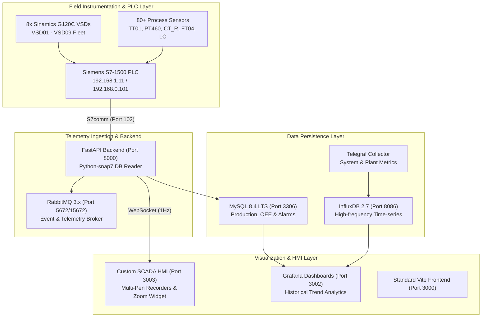

# 🏭 TH-PACK INTELLIGENT SCADA & PLANT ANALYTICS SYSTEM
## ระบบควบคุมและวิเคราะห์ข้อมูลอัจฉริยะ TH-Pack (Siemens S7-1500 & Multi-Tier Architecture)

> **Architect & Lead Developer:** xFreedom777 (<xDev.0777@gmail.com>)  
> **Project Owner / Supervisor:** Dream Piyapong / CJ (<x92120@gmail.com>)  
> **Host Node:** `xuht-001` (`192.168.1.2`)  
> **Target PLC:** Siemens SIMATIC S7-1500 (`192.168.1.11` / `192.168.0.101`)

---

## 🌐 Quick Access Directory (สารบัญพอร์ตและบริการ)

| บริการ / Service | พอร์ต / Port | URL การเข้าถึง / URL | คำอธิบาย / Description |
| :--- | :--- | :--- | :--- |
| **Custom SCADA HMI** | `3003` | [http://192.168.1.2:3003/](http://192.168.1.2:3003/) | **Executive Dashboard & Real-Time Multi-Pen Process Recorders, Zoom Control (50%-200%), Sinamics G120C Bay** |
| **Grafana Analytics** | `3002` | [http://192.168.1.2:3002/](http://192.168.1.2:3002/) | แดชบอร์ดวิเคราะห์ประวัติย้อนหลัง & ระบบแจ้งเตือน (Historical Trends & Alarms) |
| **Frontend Web** | `3000` | [http://192.168.1.2:3000/](http://192.168.1.2:3000/) | Standard Vite React/Vue UI Client |
| **SCADA Backend API** | `8000` | [http://192.168.1.2:8000/docs](http://192.168.1.2:8000/docs) | FastAPI + S7comm Snap7 PLC Reader + WebSocket Telemetry Stream (1Hz) |
| **phpMyAdmin** | `8080` | [http://192.168.1.2:8080/](http://192.168.1.2:8080/) | ระบบจัดการฐานข้อมูล MySQL แบบสมบูรณ์ (Full Web DB Admin) |
| **Adminer** | `8081` | [http://192.168.1.2:8081/](http://192.168.1.2:8081/) | เว็บจัดการฐานข้อมูลน้ำหนักเบา (Lightweight DB Tool) |
| **MySQL 8.4 Server** | `3306` | `192.168.1.2:3306` | Relational DB (Batch Logs, Recipes, Production Targets, OEE) |
| **InfluxDB 2.7** | `8086` | [http://192.168.1.2:8086/](http://192.168.1.2:8086/) | Time-Series Database สำหรับจัดเก็บข้อมูลเซนเซอร์ความถี่สูง |
| **RabbitMQ Admin** | `15672` | [http://192.168.1.2:15672/](http://192.168.1.2:15672/) | AMQP Message Broker Management Console |
| **RabbitMQ Core** | `5672` | `192.168.1.2:5672` | AMQP Telemetry & Event Queue Protocol |

---

## 🇹🇭 สถาปัตยกรรมระบบโดยละเอียด (System Architecture - Thai)

ระบบ **TH-PACK Intelligent SCADA** ออกแบบตามสถาปัตยกรรมระดับอุตสาหกรรม (Industrial Multi-Tier Architecture) แบ่งออกเป็น 4 ระดับหลัก:

### 1. ระดับอุปกรณ์และเครื่องมือวัดภาคสนาม (Field Instrumentation & PLC Layer)
- **Siemens SIMATIC S7-1500 PLC (`192.168.1.11` / `192.168.0.101`)**: ศูนย์กลางควบคุมกระบวนการผลิตผ่านโปรโตคอล S7comm (Rack 0, Slot 1)
- **เครื่องมือวัดมากกว่า 80 รายการ ครอบคลุม 5 ส่วนการผลิตหลัก**:
  1. **UHT Sterilizer (DB1200)**: อุณหภูมิสเตอริไลซ์ TT01 (137-142°C), อุณหภูมิพรีฮีท TT02/TT04, อัตราไหล FT04FIQ, ระดับถังบาลานซ์ LT, และชุดควบคุมแรงดัน
  2. **Aseptic Tank ATANK (DB1301)**: แรงดันอากาศปลอดเชื้อ PT460, อุณหภูมิสเตอร์ไรด์ TT460, อุณหภูมิแบริเออร์ TT477, ระดับของเหลว LC %, ความเร็วใบกวน VSD09
  3. **CIP Systems Line 1 & Line 2 (DB1400 / DB1500)**: ค่าความนำไฟฟ้าล้างกรด-ด่าง CT_R, อุณหภูมิคืนกลับ TT_R, อัตราไหลจ่าย FT_S, ปั๊ม VSD04 / VSD05
  4. **Production Raw Material Supply & Filter (DB1100)**: แรงดันเข้าไส้กรอง PT_IN, แรงดันออก PT_OUT, ผลต่างแรงดันไส้กรองตัน $\Delta P$, ปั๊ม P101 (VSD08)
  5. **Sinamics G120C Drive Bay Cockpit (8 ตัว)**: VSD01, VSD02, VSD03, VSD04, VSD05, VSD06, VSD08, VSD09 มอนิเตอร์กำลังไฟฟ้า (kW), รอบความเร็ว (%), กระแส (A), ความถี่ (Hz), อุณหภูมิ (°C) และสถานะ Fault/Run

### 2. ระดับสื่อสารและประมวลผลหลังบ้าน (Ingestion & Backend Microservice Layer)
- **`thpack_backend` (FastAPI + Python-snap7)**:
  - เชื่อมต่อดึงข้อมูลสดจาก PLC S7-1500 ผ่าน TCP/IP พอร์ต 102
  - ทำ Data Normalization, Bit Masking, Float Conversion และ Linear Scaling ตาม Data Block (DB)
  - Broadcast ข้อมูลสดผ่าน **WebSocket (`/ws/telemetry`)** ด้วยความถี่ 1 Hz ไปยังหน้าจอ HMI Kiosk
  - ส่งข้อมูลไปยัง RabbitMQ Message Broker สำหรับงานประมวลผลแบบกระจายศูนย์

### 3. ระดับจัดเก็บข้อมูล (Data Persistence Layer)
- **InfluxDB 2.7 & Telegraf**: จัดเก็บข้อมูลอนุกรมเวลา (Time-Series) เพื่อพล็อตแนวโน้มย้อนหลังในระยะยาว
- **MySQL 8.4 LTS**: จัดเก็บข้อมูลประวัติกะ (Shifts), การใช้วัตถุดิบ, ยอดผลผลิต (Target vs Actual), ค่า OEE ประจำกะ/วัน/สัปดาห์/เดือน/ปี และประวัติ Alarms

### 4. ระดับส่วนติดต่อผู้ใช้ (Executive HMI & Visualization Layer)
- **Custom SCADA HMI (`Port 3003`)**:
  - พัฒนาด้วย Glassmorphism Luxury Industrial UI
  - **Section-Dedicated Multi-Pen Process Recorders**: ปากกาบันทึกเส้นกราฟกระบวนการแยกรายแผนก (UHT, ATANK, CIP, Production Supply) รองรับการ Pause/Resume, สลับช่วงเวลาดู 60s, 2m, 5m และคลิกเปิด-ปิด Pen แต่ละสีได้อิสระ
  - **Dynamic Canvas Auto-Resize**: ระบบ ResizeObserver และ Tab-Activation Listener อัตโนมัติ แก้ไขปัญหากราฟแบนหรือย่อขนาดเวลาสลับแท็บ โดยผู้ใช้ไม่ต้องกดซูมเข้าออก
  - **Interactive Zoom Controller**: วิดเจ็ตซูมมุมขวาบนแบบสไลเดอร์และดรอปดาวน์ (50% ถึง 200%) พร้อมบันทึกสถานะผ่าน LocalStorage
  - **Sinamics G120C Drive Bay Cockpit**: แดชบอร์ดสรุปกำลังขับอินเวอร์เตอร์ 8 เครื่อง พร้อมระบบตัวกรองแผนก

---

## 🇬🇧 Complete System Architecture (English)

The **TH-PACK Intelligent SCADA** platform is built on an enterprise-grade industrial telemetry and visualization stack, organized into 4 decoupled layers:



### 1. Field Layer (Siemens S7-1500 & Inverters)
- Direct S7comm interface reading DB1100 (Supply), DB1200 (UHT), DB1301 (Aseptic Tank), DB1400/DB1500 (CIP Line 1 & 2), and DB1600 (Sinamics Inverter Fleet).
- Real-time tracking of critical sterilization parameters (UHT Sterilization Integrity: 137.0°C - 142.0°C; ATANK Sterile Barrier Pressure: 2.10 - 2.80 bar).

### 2. Microservices & Ingestion
- Fully Dockerized environment defined in `docker-compose.yml`.
- FastAPI provides automatic API schema at `/docs` and streams live telemetry via non-blocking WebSockets.

### 3. Real-Time Process Recorders
- High-fidelity canvas trend recorders with multi-axis scaling (Temperature, Flow, Pressure, Power, Speed).
- Integrated `ResizeObserver` engine that automatically restores full viewport aspect ratio upon tab switching without requiring manual zoom interaction.

---

## 🛠 Operation & Deployment Commands

### Running Services with Docker Compose
```bash
# Start all containers in background
docker compose up -d

# Reload Custom Dashboard without downtime
docker compose restart custom_dashboard

# View live container status
docker ps --format "table {{.Names}}\t{{.Status}}\t{{.Ports}}"

# Inspect backend logs
docker compose logs -f backend
```

### Database Credentials (`.env`)
```env
MYSQL_HOST=mysql
MYSQL_PORT=3306
MYSQL_DATABASE=thpack_dashboard
MYSQL_USER=thpack_user
MYSQL_PASSWORD=thpack_pass123
MYSQL_ROOT_PASSWORD=rootpassword123

INFLUXDB_ORG=thpack
INFLUXDB_BUCKET=telemetry
INFLUXDB_ADMIN_TOKEN=thpack-telemetry-token-123

GRAFANA_ADMIN_USER=admin
GRAFANA_ADMIN_PASSWORD=adminpassword123
```

---

## 👥 Contributors & Version Control

- **Lead Engineer & System Architect:** **xFreedom777** ([xDev.0777@gmail.com](mailto:xDev.0777@gmail.com))
- **Owner & Supervisor:** **Dream Piyapong (CJ)** ([x92120@gmail.com](mailto:x92120@gmail.com))
- **Repository:** `https://github.com/x92120/TH-Pack-DashBoard.git`
