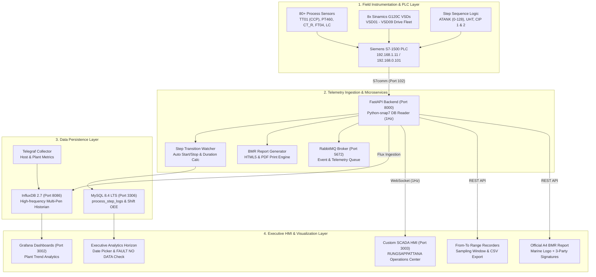

# 🏭 TH-PACK INTELLIGENT SCADA & PLANT ANALYTICS SYSTEM
## ระบบควบคุมและวิเคราะห์ข้อมูลอัจฉริยะ TH-Pack (Siemens S7-1500 & Multi-Tier Architecture)

> **Client:** TH-PACK Industrial Automation  
> **Plant Site (หน้างานจริง):** บริษัท รุ่งทรัพย์พัฒนา (ประเทศไทย) จำกัด / **RUNGSAPPATTANA (THAILAND) CO., LTD.**  
> **Engineer & System Developer:** Dream Piyapong xFreedom777 ([xDev.0777@gmail.com](mailto:xDev.0777@gmail.com))  
> **Host Node:** `xuht-001` (`192.168.1.2`)  
> **Target PLC:** Siemens SIMATIC S7-1500 (`192.168.1.11` / `192.168.0.101`)  
> **System Commissioning Date (วันเริ่มติดตั้งระบบ):** 10 ตุลาคม 2026 (2026-10-10)

<div align="center">

[](#)
[](#)
[](#)

[-007db8?style=for-the-badge&logo=dell&logoColor=white)](#)
[](#)

[](#)
[-8b1a1a?style=for-the-badge&logo=googlechrome&logoColor=white)](#)

[](https://github.com/xFreedom777)
[](#)
[](#)

</div>

---

## 🌐 Quick Access Directory (สารบัญพอร์ตและบริการ)

| บริการ / Service | พอร์ต / Port | URL การเข้าถึง / URL | คำอธิบาย / Description |
| :--- | :--- | :--- | :--- |
| **Custom SCADA HMI** | `3003` | [http://192.168.1.2:3003/](http://192.168.1.2:3003/) | **Executive Dashboard, From-To Historian Recorders, Zoom Control (50%-200%), Sinamics G120C Cockpit** |
| **Grafana Analytics** | `3002` | [http://192.168.1.2:3002/](http://192.168.1.2:3002/) | แดชบอร์ดวิเคราะห์ประวัติย้อนหลัง & ระบบแจ้งเตือน (Historical Trends & Alarms) |
| **Frontend Web** | `3000` | [http://192.168.1.2:3000/](http://192.168.1.2:3000/) | Standard Vite React/Vue UI Client |
| **SCADA Backend API** | `8000` | [http://192.168.1.2:8000/docs](http://192.168.1.2:8000/docs) | FastAPI + S7comm Snap7 PLC Reader + WebSocket Telemetry Stream (1Hz) + BMR PDF Report API |
| **phpMyAdmin** | `8080` | [http://192.168.1.2:8080/](http://192.168.1.2:8080/) | ระบบจัดการฐานข้อมูล MySQL แบบสมบูรณ์ (`thpack_dashboard`) |
| **Adminer** | `8081` | [http://192.168.1.2:8081/](http://192.168.1.2:8081/) | เว็บจัดการฐานข้อมูลน้ำหนักเบา (Lightweight DB Tool) |
| **MySQL 8.4 Server** | `3306` | `192.168.1.2:3306` | Relational DB (`process_step_logs`, Batch Logs, Recipes, Production Targets, OEE) |
| **InfluxDB 2.7** | `8086` | [http://192.168.1.2:8086/](http://192.168.1.2:8086/) | Time-Series Database สำหรับจัดเก็บข้อมูลเซนเซอร์ความถี่สูง & ประวัติย้อนหลัง 1 ปี |
| **RabbitMQ Admin** | `15672` | [http://192.168.1.2:15672/](http://192.168.1.2:15672/) | AMQP Message Broker Management Console |
| **RabbitMQ Core** | `5672` | `192.168.1.2:5672` | AMQP Telemetry & Event Queue Protocol |

---

## 🇹🇭 สถาปัตยกรรมระบบโดยละเอียด (System Architecture)

ระบบ **TH-PACK Intelligent SCADA** พัฒนาขึ้นเพื่อรองรับมาตรฐานอุตสาหกรรมอาหารและเครื่องดื่ม (GMP/BMR Compliant) ของโรงงาน **บริษัท รุ่งทรัพย์พัฒนา (ประเทศไทย) จำกัด** โดยแบ่งสถาปัตยกรรมออกเป็น 4 ระดับ:



### 1. ระดับอุปกรณ์และเครื่องมือวัดภาคสนาม (Field Instrumentation & PLC Layer)
- **Siemens SIMATIC S7-1500 PLC (`192.168.1.11` / `192.168.0.101`)**: ศูนย์กลางควบคุมกระบวนการผลิตผ่านโปรโตคอล S7comm (Rack 0, Slot 1)
- **Data Block Mapping & TIA Portal Text Lists**:
  1. **UHT Sterilizer (DB1200)**: อุณหภูมิสเตอริไลซ์ TT01 (CCP: 137–142°C), อุณหภูมิพรีฮีท TT02/TT04, อัตราไหล FT04, ระดับถังบาลานซ์ LT
  2. **Aseptic Tank ATANK (DB1301)**: แรงดันอากาศปลอดเชื้อ PT460 (2.10–2.80 bar), อุณหภูมิสเตอร์ไรด์ TT460, อุณหภูมิแบริเออร์ TT477, ระดับถัง LC %, พร้อมลำดับขั้นตอน **`A_TANK_STEP` ครบ 0 ถึง 128** ตาม TIA Portal Text list (เช่น Step 24/26 Condensate Drain, Step 28 Ready Production, Step 30 Production, Step 66 Plant Cleaning)
  3. **CIP Systems Line 1 & Line 2 (DB1400 / DB1500)**: ความนำไฟฟ้าล้างกรด-ด่าง CT_R, อุณหภูมิคืนกลับ TT_R, อัตราไหลจ่าย FT_S
  4. **Production Raw Material Supply & Filter (DB1100)**: แรงดันเข้าไส้กรอง PT_IN, แรงดันออก PT_OUT, ผลต่างแรงดัน $\Delta P$, ปั๊ม P101 (VSD08)
  5. **Sinamics G120C Drive Bay (8 เครื่อง)**: VSD01 ถึง VSD09 มอนิเตอร์ Power (kW), Speed (%), Current (A), Hz, อุณหภูมิ และ Fault Flags

### 2. ระดับสื่อสารและประมวลผลหลังบ้าน (Decoupled Industrial Ingestion & Watchdog Microservices)
- **Standalone Telemetry Worker (`telemetry_worker.py`)**:
  - โพรเซสดูดข้อมูลแยกอิสระ (Dedicated Daemon) ทำงานที่ความถี่ 1 Hz ผ่าน S7comm พอร์ต 102
  - **Zero-Block Decoupling**: ไม่ถูกบล็อกหรือหน่วงเวลาโดย HTTP Request, SQL Query หนักๆ หรือการเชื่อมต่อ WebSocket ของผู้ใช้งานบนหน้าเว็บ
  - บันทึกข้อมูลลง **InfluxDB 2.7 Historian** และประมวลผล **Step Transition Engine (`step_tracker.py`)** ลง MySQL
  - เขียนหน่วยความจำแคชแบบ Atomic File (`/tmp/scada_live_cache.json`) เพื่อส่งต่อให้ Web API ใช้ทรัพยากรต่ำสุด
  - ส่งสัญญาณชีพจรระบบ (Industrial Heartbeat) ไปยัง `/tmp/scada_heartbeat.json` ทุกรอบการทำงาน
  - **Socket Watchdog Guard**: มีระบบตรวจจับข้อผิดพลาด S7comm หากสัญญาณขาดติดต่อเกิน 3 ครั้ง จะทำการ Re-handshake กับ S7-1500 อัตโนมัติทันที
- **FastAPI API Gateway & Industrial Watchdog Supervisor (`app/main.py`)**:
  - **Watchdog Supervisor Loop**: ตรวจสอบ Heartbeat ของ Worker ทุก 5 วินาที หาก Worker ค้างหรือตาย (Heartbeat > 10 วินาที) ระบบจะ **Auto-Recover (เกิดใหม่ทันที)** ไร้การหยุดชะงัก
  - **WebSocket High-Performance Broadcaster**: อ่านข้อมูลจากแคชส่งต่อให้เบราว์เซอร์ HMI โดยตรง
  - **Comprehensive Health Diagnostics (`GET /api/v1/health`)**: ส่งออกข้อมูลสถานะสุขภาพระบบอย่างละเอียด (Worker PID, Uptime, Poll Count, Latency ms, PLC Connection Status)
  - **REST API Endpoints**:
    - `GET /api/v1/telemetry/history`: รองรับตัวกรอง `from_time`, `to_time`, `window` (Sampling resolution)
    - `GET /api/v1/process_logs`: เรียกดูประวัติ Step Logs พร้อมตัวกรอง From-To
    - `GET /api/v1/process_logs/report`: สร้างเอกสารรายงาน A4 Portrait BMR พร้อมตราสัญลักษณ์ Marine และช่องลงนาม 3 ฝ่าย

### 3. ระดับจัดเก็บข้อมูล (Data Persistence Layer)
- **MySQL 8.4 LTS (`thpack_dashboard`)**:
  - ตาราง **`process_step_logs`**: จัดเก็บประวัติขั้นตอนกระบวนการผลิตพร้อมสถิติเซนเซอร์และสถานะการตรวจสอบ (Validation Result: OK/NG)
  - จัดเก็บข้อมูลกะการทำงาน (Shift A / Shift B), ยอดผลผลิตจริงเทียบเป้าหมาย, และค่าประสิทธิผล OEE
- **InfluxDB 2.7 (`telemetry`)**: จัดเก็บ Time-series ความถี่สูง สำหรับพล็อตแนวโน้มย้อนหลัง 1 ปี (Historian Mode)

### 4. ระดับส่วนติดต่อผู้ใช้ (Executive HMI & Visualization Layer)
- **Custom SCADA HMI (`Port 3003`)**:
  - **Executive Analytics Overview**: วิเคราะห์ภาพรวมฝ่ายบริหาร 4 ระดับเวลา (Daily, Weekly, Monthly, Yearly)
  - **Date Picker Filter & FAULT NO DATA Guard**: รองรับการเลือกวันที่ดูย้อนหลัง โดยมีระบบป้องกันข้อมูลหลอก — หากเลือกวันที่ก่อนเริ่มติดตั้งระบบจริง (**ก่อน 10 ตุลาคม 2026**) ระบบจะแสดงป้ายเตือน **`⚠️ FAULT: NO DATA`** อย่างโปร่งใส
  - **From-To Historian Modal**: กล่องเลือกช่วงวันและเวลาเริ่มต้น-สิ้นสุดในตัวบันทึกกราฟทั้ง 4 หมวด (UHT, ATANK, CIP, Duplex Filter) พร้อมเลือกความละเอียด Sampling (10s, 1m, 5m, 15m, 1h) และปุ่มดาวน์โหลด CSV (UTF-8 BOM ภาษาไทย)
  - **Official A4 Portrait BMR Report**: รายงานทางการพร้อมตราสัญลักษณ์ **marine (มารีน)** ฉบับเต็มขอบมนไม่มีการตัดขอบ ระบุชื่อโรงงาน **บริษัท รุ่งทรัพย์พัฒนา (ประเทศไทย) จำกัด**

---

## 📅 บันทึกความคืบหน้าการพัฒนา (Development Progress Log: 11 ตุลาคม 2026)

| ลำดับ | รายการพัฒนา / Feature | สถานะ | รายละเอียดการดำเนินงาน |
| :---: | :--- | :---: | :--- |
| **1** | **MySQL Table `process_step_logs`** | ✅ เสร็จสมบูรณ์ | สร้างตารางจัดเก็บประวัติ Step แยกราย Section (uht, atank, cip_line1, cip_line2) พร้อมฟิลด์ Start/Stop, Duration, และค่าสถิติเซนเซอร์ |
| **2** | **Step Transition Engine (`step_tracker.py`)** | ✅ เสร็จสมบูรณ์ | เชื่อมต่อเข้ากับ Background PLC Polling Loop ตรวจจับ Step เปลี่ยนค่าแบบ Real-time และบันทึกลงฐานข้อมูลอัตโนมัติ |
| **3** | **ATANK Step List 0–128 (TIA Portal Text List)** | ✅ เสร็จสมบูรณ์ | ปรับปรุงพจนานุกรมขั้นตอน A_TANK_STEP ครบ 100% ตามหน้างานจริง (Step 24/26 Condensate Drain, Step 28 Ready Production, Step 30 Production, Step 66 Plant Cleaning ฯลฯ) |
| **4** | **Official A4 BMR Report Generator** | ✅ เสร็จสมบูรณ์ | สร้างระบบรายงานมาตรฐาน A4 Portrait พร้อมฝัง Base64 ตราสัญลักษณ์ **marine (มารีน)** เต็มใบขอบมน, ตารางข้อมูล Step, และช่องลงนาม 3 ฝ่าย (Operator, QC, ผจก.ผลิต) |
| **5** | **RUNGSAPPATTANA (THAILAND) Branding** | ✅ เสร็จสมบูรณ์ | ปรับเปลี่ยนชื่อโรงงานหน้างานจริงเป็น **บริษัท รุ่งทรัพย์พัฒนา (ประเทศไทย) จำกัด (RUNGSAPPATTANA (THAILAND) CO., LTD.)** ทั้งในหัวเอกสารและแถบหลักแดชบอร์ด |
| **6** | **From-To Date & Time Filter (Historian & Reports)** | ✅ เสร็จสมบูรณ์ | เพิ่มกล่องเลือกวัน-เวลาเริ่มต้น (From) และสิ้นสุด (To) ในตัวบันทึกกราฟและหน้าต่างออกรายงาน Step Log พร้อมปรับ Sampling Resolution |
| **7** | **Overview Date Picker & Strict FAULT NO DATA** | ✅ เสร็จสมบูรณ์ | เพิ่มตัวกรองเลือกวันที่ในหน้า Overview พร้อมตั้งเงื่อนไขวันเริ่มติดตั้งจริง (10 ต.ค. 2026) หากเลือกวันก่อนหน้านี้จะแสดง **`FAULT: NO DATA`** โปร่งใส ไม่มีการปั้นข้อมูล |
| **8** | **Decoupled Worker & Watchdog Auto-Recover** | ✅ เสร็จสมบูรณ์ | แยก Ingestion Worker (`telemetry_worker.py`) ออกจาก FastAPI พร้อมระบบ Watchdog Supervisor ตรวจจับ Heartbeat และกู้ชีพโพรเซสกลับคืนทันทีหากล้มเหลว รองรับความเสถียรเกรดอุตสาหกรรม (OT High Availability) |

---

## 🛠 Operation & Deployment Commands

```bash
# 1. Start all containers in background
docker compose up -d

# 2. Deploy & reload updated SCADA frontend
docker cp custom_dashboard/index.html thpack_custom_dashboard:/usr/share/nginx/html/index.html
docker cp custom_dashboard/style.css thpack_custom_dashboard:/usr/share/nginx/html/style.css
docker cp custom_dashboard/app.js thpack_custom_dashboard:/usr/share/nginx/html/app.js
docker exec thpack_custom_dashboard nginx -s reload

# 3. Restart Backend microservice
docker restart thpack_backend

# 4. View running containers
docker ps --format "table {{.Names}}\t{{.Status}}\t{{.Ports}}"
```

---

## 👥 Contributors & Version Control

- **End-User Plant:** **บริษัท รุ่งทรัพย์พัฒนา (ประเทศไทย) จำกัด (RUNGSAPPATTANA (THAILAND) CO., LTD.)**
- **Client & Automation Contractor:** **TH-PACK Industrial Automation**
- **Engineer & System Developer:** **Dream Piyapong xFreedom777** ([xDev.0777@gmail.com](mailto:xDev.0777@gmail.com))
- **Repository:** `https://github.com/xFreedom777/TH-Pack-DashBoard.git`
